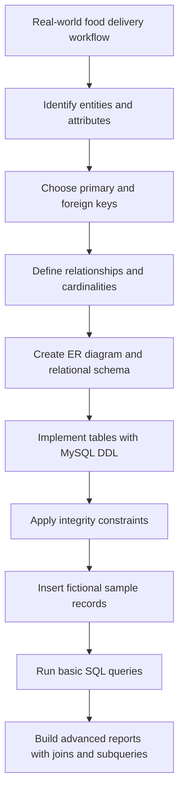

🗄️ Database Management Systems

College DBMS Coursework & Practical Database Project
Database Design · ER Modelling · Relational Schema · MySQL · SQL Reporting

🎓 Alliance University · BCA

👋 About this repository
This repository contains my Database Management Systems (DBMS) coursework, design diagrams, assignment reports, and MySQL scripts. The central project is an Online Food Delivery System: a practical example used to explore how a real-world workflow can be represented, implemented, constrained, populated, and queried in a relational database.

The assignment sequence moves from design → implementation → data integrity → sample data → SQL analysis. The same core database model is used throughout, so the reports and scripts build on one another.
Academic project: Sample records are fictional and are included for learning and demonstration only. This is coursework, not a production food-delivery service.

🧭 Quick navigation
Resource	What you'll find
Assignments 3–9	Separate PDF reports for each assignment
ER diagram	Visual model and core relationships
MySQL scripts	Setup, constraints, sample data, and query files
Repository structure	Where project materials are stored
Tools and concepts	Technologies and DBMS skills covered

🍔 Project at a glance
The Online Food Delivery System models customers placing restaurant orders, selecting menu items, choosing a delivery address, receiving delivery-partner assignment, and recording payment status.
Core entities
Entity	Purpose
Customer	Customer account and contact details
Address	Addresses owned by customers
Restaurant	Restaurant details and rating
Menu_Item	Menu items, prices, and availability
Delivery_Partner	Delivery partner and vehicle information
Orders	Order, customer, restaurant, address, and delivery references
Order_Item	Line items connecting orders to menu items
Payment	Payment method, status, and payment date

Database design
The design includes primary and foreign keys, a composite key on Order_Item, uniqueness rules, check constraints, and default values. The Order_Item table resolves the many-to-many relationship between orders and menu items.
Relationship	Cardinality	Explanation
Customer → Address	1:N	A customer may save multiple addresses
Customer → Orders	1:N	A customer may place multiple orders
Restaurant → Menu_Item	1:N	A restaurant can offer multiple menu items
Restaurant → Orders	1:N	A restaurant can receive multiple orders
Delivery_Partner → Orders	1:N	A partner may be assigned multiple orders over time
Orders → Order_Item	1:N	An order contains one or more line items
Menu_Item → Order_Item	1:N	A menu item may appear in many order lines
Orders ↔ Menu_Item	M:N	Implemented through Order_Item
Orders → Payment	1:1	The coursework schema permits one payment record per order

ER diagram

  

More diagram versions are available in the [ER Diagram Design folder](ER%20Diagram%20Design/).
📝 Assignments 3 to 9
Each report is stored as a separate PDF in the PDF/ folder. The links below use the canonical filenames without duplicate suffixes.
Assignment	Focus	PDF	Related SQL
3	Database Design Analysis — redundancy, anomalies, functional dependencies, and improvements	[Open PDF](PDF/Assignment_3_Database_Design_Analysis.pdf)	—
4	Relational Database vs. NoSQL — scalability, consistency, performance, and use cases	[Open PDF](PDF/Assignment_4_Relational_vs_NoSQL.pdf)	—
5	Database Creation and Table Implementation — database and table DDL	[Open PDF](PDF/Assignment_5_Database_Creation.pdf)	[Complete setup](mysQL/Complete_Online_Food_Delivery_Setup.sql)
6	Data Integrity Constraints — PK, FK, UNIQUE, CHECK, and DEFAULT	[Open PDF](PDF/Assignment_6_Integrity_Constraints.pdf)	[Complete setup](mysQL/Complete_Online_Food_Delivery_Setup.sql)
7	Sample Data Insertion — realistic fictional data for the core tables	[Open PDF](PDF/Assignment_7_Sample_Data_Insertion.pdf)	[Complete setup](mysQL/Complete_Online_Food_Delivery_Setup.sql)
8	Basic SQL Queries — WHERE, ORDER BY, GROUP BY, HAVING, and aggregate functions	[Open PDF](PDF/Assignment_8_Basic_SQL_Queries.pdf)	[Basic queries](mysQL/Assignment_8_Basic_SQL_Queries.sql)
9	Advanced SQL — joins, subqueries, and multi-table reports	[Open PDF](PDF/Assignment_9_Advanced_SQL_Joins_Subqueries.pdf)	[Advanced queries](mysQL/Assignment_9_Advanced_SQL_Queries.sql)

Foundations: Assignments 1 and 2
The initial application analysis and ER-model design underpin the later assignments. The repository's current PDF/ and Word/ folders include the available Assignment 2 documents, while the ER diagram folder contains the design images.
- [Assignment 2 PDF — DBMS Assignment](PDF/DBMS%20Assignment%202%20-%20Online%20Food%20Delivery%20System.pdf)
- [Assignment 2 PDF — Online Food Delivery ER](PDF/Online_Food_Delivery_ER_Assignment2.pdf)
- [Assignment 2 Word document](Word/DBMS%20Assignment%202%20-%20Online%20Food%20Delivery%20System.docx)
- [Browse all PDF reports](PDF/)
- [Browse all Word documents](Word/)
💻 MySQL scripts and run order
Available scripts
Script	Purpose
[`Complete_Online_Food_Delivery_Setup.sql`](mysQL/Complete_Online_Food_Delivery_Setup.sql)	Creates the eight core tables, applies constraints, inserts sample data, and runs integrity/count checks for Assignments 5–7
[`Assignment_8_Basic_SQL_Queries.sql`](mysQL/Assignment_8_Basic_SQL_Queries.sql)	Filtering, sorting, grouping, HAVING, aggregates, and bonus queries
[`Assignment_9_Advanced_SQL_Queries.sql`](mysQL/Assignment_9_Advanced_SQL_Queries.sql)	Multi-table joins, subqueries, summary reports, and integrity audit
[`online_food_delivery_schema.sql`](mysQL/online_food_delivery_schema.sql)	Core relational schema / table definitions

Recommended run order
1. Open MySQL Workbench or another MySQL 8.0.16+ client.
2. Run Complete_Online_Food_Delivery_Setup.sql once against a fresh or empty coursework schema. It creates the database and tables, adds constraints, inserts fictional sample records, and runs validation queries.
3. Run Assignment_8_Basic_SQL_Queries.sql to explore foundational SQL.
4. Run Assignment_9_Advanced_SQL_Queries.sql to generate joined reports and subquery results.
Important: the complete setup script inserts sample data and is not designed to be re-run against an already populated database. Use a fresh schema before running it again. Password-related fields in the schema are named for hashes; real applications should store a securely generated password hash, never a plaintext password.
🔄 Database workflow

🧰 Tools and concepts
Tools used: MySQL, MySQL Workbench, ERDPlus / diagrams.net (Draw.io), Microsoft Word, PDF, and GitHub.
DBMS concept	Where it appears
Entities and attributes	Project model and relational tables
Primary and foreign keys	Table definitions and relationships
Cardinality	ER diagram and relationship explanation
Many-to-many modelling	Order_Item associative table
Functional dependencies and anomalies	Assignment 3
Relational vs. NoSQL trade-offs	Assignment 4
DDL and table creation	Assignment 5
UNIQUE, CHECK, DEFAULT and referential integrity	Assignment 6
INSERT and valid related data	Assignment 7
Filtering, sorting, grouping, and aggregates	Assignment 8
Joins, subqueries, and multi-table reports	Assignment 9

📂 Repository structure
Database-Management-Systems/
├── ER Diagram Design/     # ERD images and design alternatives
├── PDF/                   # Assignment reports and design PDFs
├── Word/                  # Editable Word coursework documents
├── mysQL/                 # Setup and query scripts
└── README.md              # Project guide
🎓 Learning outcomes
This coursework demonstrates how to take a real-world scenario and represent it with a relational model; explain the design; implement tables and integrity rules; insert related sample data; and use SQL to answer operational and analytical questions.
👨‍💻 Author

N.R. Vimal Kumar Rao
BCA Student · Alliance University

🗄️ Design the data · 🔗 Build the relationships · 💻 Query for insights

Learn · Model · Implement · Improve 🚀

